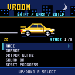
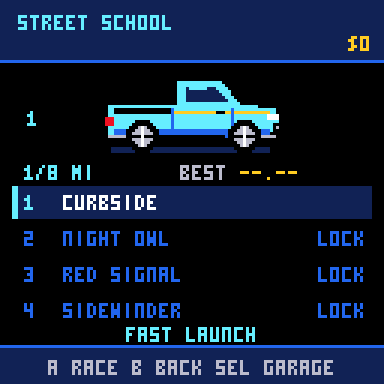
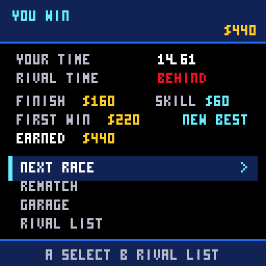
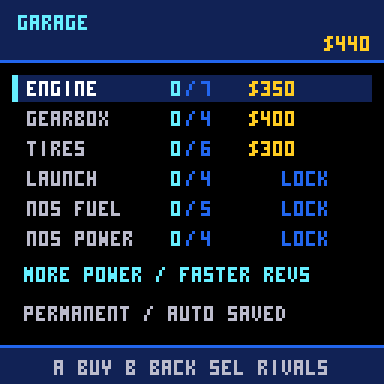

# Vroom: Shift King

Launch, shift, boost, and pulse one street racer through 36 rivals.
Earn permanent upgrades while mastering six stages and three race distances.

Play in a browser with the self-contained [Vroom web site](site/). It boots
straight into this game, with keyboard/touch controls and browser saves.
See [preview and GitHub Pages setup](docs/web-site.md).



| Choose a rival | Earn upgrades | Build your car |
| --- | --- | --- |
|  |  |  |

Cars use four body shapes, five paints, and five decal styles.
The 36 rivals have distinct appearances drawn from
[100 reusable combinations](docs/opponents-100.png).

## Controls

| Button | Action |
| --- | --- |
| A | Shift up; select or buy in menus |
| Hold / release A | After win 6: hold when the countdown says 1; release at green near 4200 RPM |
| Hold B | After win 12: use NOS; release to save fuel |
| Up | After win 18: timed overdrive pulse following a clean shift |
| Up / Down | Navigate menus |
| Left / Right | Jump six rivals in the list; change driver-guide page |
| START | Pause / resume |
| SELECT | Switch between garage and rival list |

## Rules

The first six races use automatic launches. Later races test reaction and
launch RPM: release A at green near the gold zone. Early release adds a
half-second delay; low RPM bogs down and excessive RPM loses grip.
Launch-control upgrades widen the optimal RPM band.

Tap A to shift in the gold RPM zone. Early shifts drop revs; late shifts
waste time at the limiter. Gear changes interrupt power. Extra gears unlock
automatically at milestone wins.

NOS is a hold-to-use fuel supply, refilled free for each race. Holding B
through a shift consumes fuel while power is interrupted. Tires limit how
much power reaches the road, so boosting through wheelspin wastes fuel.

A good or perfect shift opens an overdrive window after the shift interruption.
Tap Up when its moving marker and the UP NOW cue turn gold for a full pulse.
Timing elsewhere in the window gives an 80% pulse. Outside the window,
a press spends a charge without a surge. Charges refill each race.

## How to play

Six stages each contain six rivals, ending with a boss:

| Win | Reward |
| --- | --- |
| 6 | Manual launch, fourth gear, launch upgrades |
| 12 | NOS, fifth gear, fuel and pressure upgrades |
| 18 | Overdrive, sixth gear, pulse and charge upgrades |
| 24 | Seventh gear and distance-strategy stages |
| 30 | Final upgrade levels |
| 36 | Championship; continue racing and improving records |

The opening lessons are eighth-mile races. Quarter-mile races are the most
common format overall, with five half-mile challenges later in the campaign.
Opponents have fixed builds and consistent driving; bosses test new skills.

The garage has 37 purchases across engine, gearbox, tires, launch control,
NOS fuel, NOS pressure, overdrive power, and overdrive charges. Regular victories
open one or two upgrade levels at a time; the garage shows the required win
count. All of a stage’s levels are available before its boss. Stage wins
unlock new abilities free.
There is one player car and no loadout or equipment selection.

Finishing pays even on a loss. Wins pay more; first wins and skilled driving
earn bonuses. Earnings grow to support the expensive later upgrades, while
loss skill bonuses are capped. A perfect first win pays $440, enough for a starter upgrade.
Replay beaten rivals for earnings and best times. Exact ties are losses,
and a 60-second failure to finish earns nothing.

Cash, upgrades, wins, unlocks, and records autosave after results and purchases.
An interrupted race earns nothing. Reset Progress requires confirmation.
Holding START for three seconds returns to the console menu, even while paused.

MVP saves import automatically. Cash, engine/gearbox/tire levels, and completed
rival count are retained. Obsolete purchased gears and NOS receive catalog-price
credit; the new abilities follow stage milestones. Old quarter-mile bests
are archived in the driver guide rather than compared against new races.

Open `vroom.ino` in Arduino IDE with CHGame Rev0, USB **Upload only**, and
Optimize **Smallest + LTO**, or use:

```bash
python3 vroom/tools/vroom.py build
python3 vroom/tools/vroom.py upload
```

The cartridge is `vroom/build/vroom.chgame`. For desktop play:

```bash
python3 tools/run_emulator.py vroom/build/release/vroom.ino.bin
```

Space/X is A, Z is B, Up arrow is overdrive, and Enter is START.

## Developer notes

- `Game.cpp`: portable fixed-rate physics, staging, abilities, 36 rivals and economy.
- `Pilot.h`: deterministic test/debug driver, absent from release gameplay.
- `App.cpp`: menus, stage rewards, real inputs, sound and versioned save migration.
- `Appearance.cpp` and `CarArt.cpp`: reusable car designs and seamless skyline.
- `View.cpp`: launch/shift RPM instrument, fuel meter and pulse timing indicator.
- See [NOTES.md](NOTES.md) for verification, balancing and remaining playtests.

## Credits

Original game code and code-drawn art created for this project.
CHGame and CHGfx libraries by bateske, Apache-2.0.
CHGame's 3x5 font is by Press Play On Tape; see the library's NOTICE.
